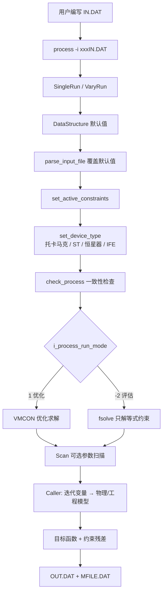

# PROCESS 数据流与用户输入梳理

本文梳理 PROCESS 的数据流：用户通过 `IN.DAT` 提供哪些输入、代码如何把这些输入变成装置设计点，以及**不同 switch 取值下需要哪些额外输入**。

PROCESS 是 UKAEA 的聚变电站系统程序。它在给定约束下自洽地计算装置物理/工程参数，并可对某个目标函数（Figure of Merit）做优化或仅做评估。

源码入口：`process/main.py` → `SingleRun` / `VaryRun`。  
输入解析：`process/core/input.py`（`INPUT_VARIABLES`）。  
运行前校验：`process/core/init.py`（`check_process`）。  
模型调用：`process/core/caller.py`（`Caller._call_models_once`）。

未在输入文件中给出的变量使用 `process/data_structure/` 中各 dataclass 的默认值。

---

## 1. 总体数据流



一次运行的内部循环（每次求解器试探一组迭代变量时）：

```
迭代变量向量 xc
    → set_scaled_iteration_variable() 写回 DataStructure
    → 按装置类型调用模型（见第 2 节）
    → 重复评估直到目标函数与约束幂等
    → 返回 objf, constraints
```

数据都挂在同一个 `DataStructure` 上（`process/core/data_structure/base.py`），各模型通过 `self.data.physics`、`self.data.build`、`self.data.tfcoil` 等读写，**没有单独的中间数据文件**。

### 1.1 用户必须提供的三类输入

| 类别 | IN.DAT 关键字 | 作用 |
|------|---------------|------|
| 约束方程 | `icc`、`n_equality_constraints` | 指定要满足的物理/工程方程 |
| 迭代变量 | `ixc`、`boundl`/`boundu` | 求解器可调整的量及其上下界 |
| 模型开关与固定参数 | 各 `i_*` switch + 物理/工程数值 | 选择模型分支，并给出非迭代量 |

其余变量均可省略，走代码默认值。实际运行时，**约束数、迭代变量数、switch 三者必须互相匹配**，否则 `check_process` 会报错。

---

## 2. 顶层装置分支

装置类型由三个顶层 switch 决定，互斥优先级如下（`Caller._call_models_once`）：

```
if istell != 0:   走恒星器模型，直接 return
elif ife != 0:    走惯性约束模型，直接 return
else:             走托卡马克（含球形托卡马克 ST）
```

`set_device_type` 据此设置 `globals.icase`：

| 条件 | `icase` |
|------|---------|
| `ife = 1` | Inertial Fusion model |
| `istell ≠ 0` | Stellarator model |
| `itart = 1` | Tight aspect ratio tokamak model |
| `i_pulsed_plant = 1` | Pulsed tokamak model |
| 以上皆否 | Steady-state tokamak model（默认） |

### 2.1 托卡马克模型调用顺序

`istell = 0` 且 `ife = 0` 时，单次模型评估顺序为：

1. `plasma_geom` — 等离子体几何  
2. `build` — 径向/轴向建造  
3. `physics` — 等离子体物理（成分、电流、剖面、β、聚变功率、约束、辐射、H&CD…）  
4. TF 线圈（按 `i_tf_sup` / `i_tf_turn_type` 分支）  
5. `pfcoil` — PF / CS  
6. `pulse` — 脉冲时序  
7. `divertor` / `fw` / `shield` / `vacuum_vessel`  
8. 包层（按 `i_blanket_type`）  
9. `cryostat` / `structure`  
10. 若 `itart = 1` 且 TF 非超导：`tfcoil`（中心柱电阻模型）  
11. `power` → `vacuum` → `buildings` → `power.acpow` → `power.plant_electric_production`  
12. `availability` → `water_use` → `costs`

### 2.2 恒星器与 IFE 提前返回

- **恒星器**（`istell = 1–6`）：`st_init()` 会关掉托卡马克特有量（CS 厚度、PF、脉冲、电流驱动、pedestal 等），再调用 `stellarator.run()`。  
- **IFE**（`ife = 1`）：只跑 `ife.run()`，不走托卡马克径向建造与 TF/PF 模型。

---

## 3. IN.DAT 文件格式

- 文件名必须以 `IN.DAT` 结尾。  
- 赋值：`name = value`，`*` 后为注释。  
- 数组：`boundl(3) = 8` 或 `sweep = 2.8, 2.9, 3.0`。  
- 约束/迭代变量可重复写多行：`icc = 2`、`ixc = 3`。  
- 合法输入名定义在 `process/core/input.py` 的 `INPUT_VARIABLES`。未知名会报错。

示例骨架：

```
i_process_run_mode = 1          * 1=优化, -2=评估
i_figure_merit = 6              * 优化目标（正=最小化，负=最大化）
n_equality_constraints = 2

icc = 1                         * β 自洽
icc = 2                         * 全局功率平衡
icc = 24                        * β 上限
ixc = 3                         * rmajor
boundl(3) = 5
boundu(3) = 12

aspect = 3.1
rmajor = 9.0
```

示例文件见 `tests/regression/input_files/`。

---

## 4. 运行模式、目标函数与扫描

### 4.1 `i_process_run_mode`

| 值 | 含义 | 求解器 | 额外输入 |
|----|------|--------|----------|
| `1`（默认） | 优化：满足约束并优化 FoM | VMCON | `i_figure_merit`、`epsvmc`、`maxcal` |
| `-2` | 评估：只解等式约束，不做优化 | fsolve | 等式约束对应的迭代变量必须足够 |

优化模式下：`n_iteration_variables ≥ n_equality_constraints`。

### 4.2 `i_figure_merit`（仅优化模式）

正值 = 最小化，负值 = 最大化。

| 值 | 目标 |
|----|------|
| 1 | 大半径 \(R_0\) |
| 3 | 中子壁负载 |
| 4 | TF+PF 线圈功率 |
| 5 | 聚变增益 \(Q\) |
| 6 | 电费成本 COE |
| 7 | 电厂资本成本（默认） |
| 8 | 环径比 |
| 9 | 偏滤器热负载 |
| 10 | 轴上环向场 \(B_0\) |
| 11 | 总注入功率 |
| 14 | 脉冲长度 |
| 15 | 电厂可用因子 |
| 16 | 最小化 \(R_0\) + 最大化燃烧时间 |
| 17 | 净电功率 |
| 18 | 空目标（Null FoM） |
| 19 | 最大化 \(Q\) + 脉冲长度 |

相关数值输入：`epsvmc`（收敛容差，默认量级 \(10^{-8}\)）、`maxcal`（最大迭代次数）、`epsfcn`。

### 4.3 扫描（可选）

扫描变量**不能**同时作为迭代变量。

**1D：**

```
nsweep = 1          * 扫描量编号
isweep = 4          * 点数
sweep = 2.8, 2.9, 3.0, 3.1
```

**2D：** 再设 `scan_dim = 2`，以及 `nsweep_2` / `isweep_2` / `sweep_2`。

---

## 5. Switch 分支与所需输入（托卡马克）

下面按子系统列出：每个 switch 的取值、含义，以及**该分支下用户需要额外给出的输入**。未列出的量一般可用默认值，或由模型计算。

“需要输入”分两类：

- **固定输入**：写在 IN.DAT 中、不作为 `ixc` 的量。  
- **迭代变量**：若该量要由求解器调整，则同时写 `ixc = N` 和初值。

---

### 5.1 等离子体几何

#### `i_plasma_shape`

| 值 | 模型 | 额外输入 |
|----|------|----------|
| `0`（默认） | PROCESS 双圆弧 | — |
| `1` | Sauter 几何（含 squareness） | `plasma_square`（方形度 \(\xi\)） |

`i_plasma_current` = 8 时也需要输入 `plasma_square`

几何尺寸始终需要（或作为迭代变量）：

- `rmajor`（ixc=3）、`aspect`（ixc=1）→ 由此算 `rminor`  
- 若用约束 21：`rminor_min`
- `f_vol_plasma`
- 若 `i_plasma_geometry` = R_AND_Z_ARRAY，则可不需要 `rmajor` `aspect` `f_vol_plasma`，
    需要 `n_lcfs_points` `r_array` `z_array`

#### `i_plasma_geometry`（κ / δ 由谁给出）

四个形状量：`kappa`、`triang`、`kappa95`、`triang95`。标记为 USER 的必须由用户输入（或作迭代变量：`kappa` ixc=175，`triang` ixc=174）。

| 值 | `kappa` | `triang` | `kappa95` | `triang95` | 其他输入 |
|----|---------|----------|-----------|------------|---------|
| 0 IPDG89 X 点 | **用户** | **用户** | IPDG89 | IPDG89 | |
| 1 STAR/FIESTA | STAR | STAR | FIESTA | FIESTA | |
| 2 Zohm ITER X 点 | Zohm | **用户** | IPDG89 | IPDG89 | |
| 3 Zohm ITER 95 | Zohm | IPDG89 | IPDG89 | **用户** | |
| 4 IPDG89 95 | IPDG89 | IPDG89 | **用户** | **用户** | |
| 5 MAST 95 | MAST | MAST | **用户** | **用户** | |
| 6 MAST X 点 | **用户** | **用户** | MAST | MAST | |
| 7 FIESTA 95 | FIESTA | FIESTA | **用户** | **用户** | |
| 8 FIESTA X 点 | **用户** | **用户** | FIESTA | FIESTA | |
| 9 电感标度 X 点 | 标度 | **用户** | IPDG89 | IPDG89 | `ind_plasma_internal_norm` |
| 10 CREATE EU-DEMO | IPDG89 | **用户** | CREATE | IPDG89 | `m_s_limit` |
| 11 Menard 2016 ST | Menard2016 | **用户** | IPDG89 | IPDG89 | |
| 12 Menard 1997 ST | Menard1997 | **用户** | IPDG89 | IPDG89 | |

ST（`itart=1`）常用 1、11、12。常规托卡马克不要用 1。

#### `i_plasma_wall_gap`

| 值 | 含义 | 额外输入 |
|----|------|----------|
| `0` | 0.1 * a | — |
| `1` | 用户指定 FW–等离子体间隙 | `dr_fw_plasma_gap_inboard`（ixc=73）、`dr_fw_plasma_gap_outboard`（ixc=74） |

#### `i_single_null`

| 值 | 含义 | 额外输入 / 副作用 |
|----|------|-------------------|
| `0` | 双零 | 上/下垂直建造被强制对称；`n_divertors=2`。ST 下若 `f_p_div_lower_separatrix` 为 0 或 1 会报警（双零装置却单零运行） |
| `1` | 单零 | 常规托卡马克必须配置 2 个独立偏滤器线圈：`i_pf_location=2` 且 `n_pf_coils_in_group=1,1` |

---

### 5.2 等离子体剖面与成分

#### 反应类型 `i_fusion_reactions`

- = "p-b11": proton-boron reactions
    需要 `i_nd_plasma_protons`
    - = 1: need `f_nd_protons_electrons_input`

#### `i_plasma_ignited`

#### 平均密度/温度

`nd_plasma_electrons_vol_avg`
`temp_plasma_electron_vol_avg_kev`

#### `i_plasma_pedestal`

| 值 | 剖面 | 剖面因子 |
|----|------|----------|
| `0` | 抛物线（L-mode） | `alphan`、`alphat` |
| `1`（常用） | pedestal（H-mode） | `alphan` `alphat` `tbeta` |

pedestal 开启时（`i_plasma_pedestal=1`）：

- 温度：`temp_plasma_pedestal_kev`、`temp_plasma_separatrix_kev`（ixc=119）、`radius_plasma_pedestal_temp_norm`  
- 必须 `temp_plasma_pedestal_kev > temp_plasma_separatrix_kev`  
- 必须 `temp_plasma_electron_vol_avg_kev`（ixc=4）> pedestal 温度  

密度 pedestal 再由 `i_nd_plasma_pedestal_separatrix` 决定：

需要 `radius_plasma_pedestal_density_norm`

| 值 | 含义 | 额外输入 |
|----|------|----------|
| `0` | 直接给密度 | `nd_plasma_pedestal_electron`、`nd_plasma_separatrix_electron`（ixc=142） |
| `1` | Greenwald 份额 | `f_nd_plasma_pedestal_greenwald`（ixc=145）、`f_nd_plasma_separatrix_greenwald`（ixc=152） |

要求 pedestal 密度 > 分离面密度。优化时若用 ixc=6 或 145，建议打开约束 81（轴上密度 > pedestal 密度）。

#### 离子温度
`f_temp_plasma_ion_electron`
- > 0.0 时，通过 `f_temp_plasma_ion_electron` 计算
- <= 0.0 时，输入 `temp_plasma_ion_vol_avg_kev`

#### 剖面计算

`n_plasma_profile_elements`

#### 等离子体组成

`f_nd_alpha_thermal_electron`
`f_nd_protium_electrons`
`f_nd_beam_electron`

必须满足：

```
f_plasma_fuel_deuterium + f_plasma_fuel_tritium + f_plasma_fuel_helium3 = 1

f_plasma_fuel_boron11 + f_plasma_fuel_proton = 1
```

`f_plasma_fuel_tritium` 可作为 ixc=173。氚份额 < 0.001 时氚工厂体积和功率被置零。

杂质：`f_nd_impurity_electrons(i)` 数组。`f_nd_impurity_electrons(2)`（热 α）必须保持默认 0.1，改用 `f_nd_alpha_thermal_electron`（ixc=109）。杂质份额 ixc=125–136 对应杂质 3–14。

#### `i_rad_loss`（约束时间辐射项）

| 值 | 含义 |
|----|------|
| 0 | 功率损失项含全部辐射 |
| 1（默认） | 只含芯部辐射 |
| 2 | 不含辐射 |

相关：`radius_plasma_core_norm`、`f_p_plasma_core_rad_reduction`。

---

### 5.3 等离子体电流、电感、β

#### `i_plasma_current`

除 0 和 2 外，均需要的输入：`q95` （ixc=18） `b_plasma_toroidal_on_axis`
| 值 | 模型 | 适用 | 额外输入 |
|----|------|------|----------|
| 1 | Peng 解析拟合 | 常规 |  |
| 2 | Peng 偏滤器标度 | **仅 ST** |  |
| 3 | 简单 ITER（圆柱） | 常规 |  |
| 4 | IPDG89 | 常规（常用） |  |
| 5 / 6 | Todd I / II | 常规 |  |
| 7 | Connor-Hastie | 常规 |  |
| 8 | Sauter | 常规 |  |
| 9 | FIESTA ST | **仅 ST** |  |
| 0 | USER INPUT | 常规 | `plasma_current_user_input` |

`itart=0` 时禁止 2、9；`itart=1` 时推荐 2 或 9。

ST 相关：`itart=1`，可选 `itartpf=0`（Peng–Strickler，强制 PF 位置为 TF 上方 + TF 外侧）。

#### `i_alphaj`

need `q0`

| 值 | 含义 | 额外输入 |
|----|------|----------|
| 0 | 用户给定电流剖面指数 | `alphaj` |
| 1 | Wesson：由 \(q_*/q_0\) 计算 ||

推荐与 `i_ind_plasma_internal_norm=1`、`i_beta_norm_max=1` 一起用（三者自洽）。

#### `i_ind_plasma_internal_norm`

| 值 | 模型 | 额外输入 |
|----|------|----------|
| 0 | 用户输入 | `ind_plasma_internal_norm` |
| 1 | Wesson | —（推荐配 `i_alphaj=1`） |
| 2 | Menard | —（推荐配 `i_beta_norm_max=3`） |

#### `i_bootstrap_current`

| 值 | 模型 | 额外输入 / 限制 |
|----|------|-----------------|
| 0 | 用户输入 | `f_c_plasma_bootstrap` |
| 1 | ITER IPDG89 | **ST 禁止** |
| 2 | Nevins | — |
| 3 | Wilson | — |
| 4 | Sauter | — |
| 5 | Sakai | — |
| 6 | ARIES | — |
| 7 | Andrade | — |
| 8 | Hoang | — |
| 9 | Wong | — |
| 10 / 11 | GI-1 / GI-2 | — |
| 12 / 13 | Sugiyama L / H | — |

非感应电流份额：`f_c_plasma_non_inductive`（ixc=44）。Bootstrap 上限：`f_c_plasma_bootstrap_max`。

#### `i_diamagnetic_current` / `i_pfirsch_schluter_current`

| 值 | 含义 |
|----|------|
| 0 | 关闭 |
| 1 | 开启（抗磁：1=模型 A，2=模型 B） |

#### `i_bootstrap_current`

需要以下输入：
`cboot`
`nd_plasma_electron_max_array[6]`
`f_c_plasma_bootstrap`(user input)
`f_c_plasma_bootstrap_max`
`f_c_plasma_non_inductive`

#### `i_beta_norm_max`

need `beta_total_vol_avg` `c_beta` `f_c_plasma_bootstrap`

| 值 | \(\beta_N^{\max}\) 来源 | 额外输入 |
|----|-------------------------|----------|
| 0 | 用户 | `beta_norm_max` |
| 1 | Wesson | — |
| 2 | 原始标度 | — |
| 3 | Menard | — |
| 4 | Tholerus | — |
| 5 | Stambaugh | — |

#### `i_beta_component`（约束 24 限制哪一项 β）

| 值 | 限制对象 |
|----|----------|
| 0 | 总 β |
| 1 | 热 β |
| 2 | 热 + 束 β |
| 3 | 环向 β |

#### `i_beta_fast_alpha`

| 值 | 含义 |
|----|------|
| 0 | 快 α 对 β 的贡献按模型计算 |
| 1 | 用户控制快 α 压强贡献 |

β 相关固定/迭代量：`beta_total_vol_avg`（ixc=5）、`beta_vol_avg_max`、`beta_vol_avg_min`、`beta_poloidal_max`、`beta_poloidal_eps_max`。

---

### 5.4 约束时间、密度极限、L-H 阈值

#### `i_confinement_time`

能量约束时间 \(\tau_E\) 标度律。常用：

| 值 | 模型 | 模态 |
|----|------|------|
| 0 | **用户输入** `tauee_in` | — |
| 6 | ITER 89-P | L |
| 26 | ITER H-97P ELM-free | H |
| 27 | ITER H-97P ELMy | H |
| 34（默认） | IPB98(y,2) | H |
| 21–23、37–38 | LHD / gyro-Bohm / Lackner–Gottardi / ISS95 / ISS04 | 恒星器 |
| 46–48 | Menard NSTX / 混合 / Buxton NSTX gyro-Bohm | H（ST） |

完整列表见 `ConfinementTimeModel`（0–52）。用户输入约束时间时设 `i_confinement_time=0` 并给出 `tauee_in`。

增强因子：`hfact`（ixc=10）。约束 2（功率平衡）通常需要 `hfact` 作为迭代变量。

#### `i_density_limit`

| 值 | 模型 | 约束 5 用到 |
|----|------|-------------|
| 1 | ASDEX | |
| 2 / 3 | Borrass ITER I / II | |
| 4 / 5 | JET 边缘辐射 / 简单 | |
| 6 | Hugill–Murakami | |
| 7（常用） | Greenwald | |
| 8 | ASDEX New | |

体平均密度：`nd_plasma_electrons_vol_avg`（ixc=6）。

#### `i_l_h_threshold`

用于约束 15（\(P_{\mathrm{sep}} > P_{LH}\)）。Reinke 杂质模型（约束 78）建议用 **6（Martin 2008 Nominal）**。

| 值 | 模型 |
|----|------|
| 1–3 | ITER-1996 名义/上/下 |
| 4–5 | Snipes 1997 |
| 6–8 | Martin 2008 名义/上/下（推荐 6） |
| 9–14 | Snipes 2000（含闭式偏滤器） |
| 15–18 | Hubbard 2012/2017（含 I-mode） |
| 19–21 | Martin 2008 环径比修正 |

---

### 5.5 加热与电流驱动（H&CD）

#### `i_hcd_calculations`

| 值 | 含义 | 额外输入 |
|----|------|----------|
| 0 | 纯感应，不算电流驱动效率 | 非感应份额应接近 0 |
| 1 | 计算 H&CD | 必须设 `i_hcd_primary` |

#### `i_plasma_ignited`

| 值 | 含义 |
|----|------|
| 0 | 非点火：注入功率进入功率平衡 |
| 1 | 点火：注入功率不进入燃烧期功率平衡，但仍计入启动加热成本 |

点火时用 `p_hcd_primary_extra_heat_mw`（ixc=11）表示启动加热。约束 28 可强制 \(Q \ge\) `big_q_plasma_min`。

#### `i_hcd_primary` / `i_hcd_secondary`

`i_hcd_secondary=0` 表示无第二套系统。9 和 11 已删除。

| 值 | 方法 | 模型 | 该分支额外输入 |
|----|------|------|----------------|
| 1 | LHCD | Fenstermacher | LH 相关效率/几何 |
| 2 | ICCD | IPDG89 | IC 频率、功率分配 |
| 3 | ECRH | Fenstermacher | — |
| 4 | LHCD | EHST | — |
| 5 | NBI | ITER | `e_beam_kev`（ixc=19）、`dx_beam_duct`；约束 7/14/20/61 |
| 6 | LHCD | Culham | — |
| 7 | ECRH | Culham | `i_ecrh_wave_mode`（0=O，1=X） |
| 8 | NBI | Culham | 同 5 |
| 10 | ECRH | 用户给定 γ | 用户输入归一化效率 |
| 12 | EBW | Freethy 用户标度 | EBW 标度系数 |
| 13 | ECRH | Freethy cutoff | `i_ecrh_wave_mode` |

公共量：

- `p_hcd_primary_extra_heat_mw`（ixc=11）— 额外加热（不驱动电流）  
- `p_hcd_injected_max` / `p_hcd_injected_min_mw` — 约束 30 / 40  
- `feffcd`（ixc=47）— 电流驱动效率缩放  
- `eta_ecrh_injector_wall_plug`、`eta_lowhyb_injector_wall_plug`、`eta_beam_injector_wall_plug`  
- 第二套：`p_hcd_secondary_injected_mw`（固定）、`p_hcd_secondary_extra_heat_mw`

非 NBI（primary 不是 5 或 8）时，`f_nd_beam_electron` 被强制为 0。

SOL 功率衰减长度 `i_len_sol_outboard_power_decay`：

| 值 | 模型 | 额外输入 |
|----|------|----------|
| 0 | 用户输入 | `lambda_q` 类变量 |
| 1 | Eich 2013 | — |
| 2 / 3 | MAST 2014 | — |

（输入允许 0–3；物理枚举还定义了 Eich 2011 等更细选项。）

中子壁负载模型 `i_pflux_fw_neutron`：1 或 2。

---

### 5.6 径向建造

常规内侧径向顺序（`i_tf_inside_cs=0`）：

```
dr_bore → dr_cs → dr_cs_precomp → dr_cs_tf_gap → dr_tf_inboard
→ 热屏蔽 → VV → 间隙 → 屏蔽 → 包层 → FW → 等离子体间隙 → 等离子体
```

关键厚度（均可作迭代变量）：

| 变量 | ixc | 说明 |
|------|-----|------|
| `dr_bore` | 29 | 中心孔 |
| `dr_cs` | 16 | CS 厚度 |
| `dr_cs_tf_gap` | 42 | CS–TF 间隙 |
| `dr_tf_inboard` | 13 | 内侧 TF 厚度（与 ixc=140 互斥） |
| `dr_tf_wp_with_insulation` | 140 | TF 绕组包厚度（与 ixc=13 互斥） |
| `dr_shld_vv_gap_inboard` | 61 | VV–热屏蔽间隙 |
| `dr_shld_inboard` / `outboard` | 93 / 94 | 屏蔽 |
| `blbuith` / `blbuoth` | 90 / 91 | 包层增殖区 |
| `gapomin` | 31 | 外侧最小间隙 |
| `f_dr_tf_outboard_inboard` | 75 | 外侧/内侧 TF 厚度比 |

**托卡马克必须保证 `dr_tf_inboard > 0`**，除非 ixc=140 由绕组包反推厚度。

#### `i_tf_inside_cs`

| 值 | 含义 | 限制 |
|----|------|------|
| 0 | TF 在 CS 外侧（默认） | — |
| 1 | TF 在 CS 内侧 | 禁止 `i_tf_bucking ≥ 2` |

#### `i_cs_precomp`

| 值 | 含义 | 限制 |
|----|------|------|
| 0 | 无 CS 预压缩结构 | `i_tf_bucking ≥ 2` 时必须为 0 |
| 1 | 有预压缩结构 | 需要 `dr_cs_precomp` |

#### `i_blkt_inboard`

| 值 | 含义 | 副作用 |
|----|------|--------|
| 0 | 无内侧包层 | `dr_blkt_inboard` 被置 0 |
| 1 | 有内侧包层 | `dr_blkt_inboard`、`blbuith` 等 |

#### `i_fw_blkt_vv_shape`

| 值 | 形状 |
|----|------|
| 1 | D 形 |
| 2 | 椭圆 |

#### `i_r_cp_top`（ST 中心柱顶部半径）

| 值 | 含义 | 额外输入 |
|----|------|----------|
| 0 / 2 | 不由用户直接指定 `r_cp_top` | — |
| 1 | 用户指定中心柱顶半径 | `r_cp_top`（ixc=162）。要设该值必须 `i_r_cp_top=1` |

---

### 5.7 TF 线圈

#### `i_tf_sup`（导体类型，最关键的工程开关）

| 值 | 导体 | 调用模型 | 该分支额外输入 |
|----|------|----------|----------------|
| 0 | 水冷铜 | `copper_tf_coil` | `temp_cp_coolant_inlet ≥ 273.15 K`；`temp_tf_legs_outboard` 若给定也须 ≥ 273.15 K；ST 下常用滑动接头 |
| 1 | 超导 | `cicc_sctfcoil` 或 `croco_sctfcoil` | 见 `i_tf_sc_mat`、`i_tf_turn_type` |
| 2 | 氦冷铝 | `aluminium_tf_coil` | `temp_cp_coolant_inlet < 40 K`；`temp_tf_legs_outboard < 50 K`；ixc=20 上界 ≤ 50 K |

ST + 铜/铝时还会跑 `tfcoil.run()`（中心柱电阻）。ST + 超导时接头电阻不计算（警告）。

#### `i_tf_turn_type`（仅超导）

| 值 | 匝型 | 调用 | 额外输入 |
|----|------|------|----------|
| 1 | CICC | `cicc_sctfcoil` | 电缆空隙、铜份额 `f_a_tf_turn_cable_copper`（ixc=59）、`c_tf_turn`（ixc=60） |
| 2 | CroCo | `croco_sctfcoil` | `dx_tf_hts_tape_rebco`（ixc=138）、`dx_tf_hts_tape_copper`（ixc=139）、`dx_tf_croco_strand_copper`（ixc=158） |

#### `i_tf_sc_mat`（超导体材料模型）

| 值 | 材料 | 额外输入 |
|----|------|----------|
| 1 | ITER Nb₃Sn | — |
| 2 | Bi-2212 | — |
| 3 | 旧 Lubell NbTi | — |
| 4 | 用户定义 Nb₃Sn | `bcritsc`、`tcritsc` |
| 5 | WST Nb₃Sn | — |
| 6 | CroCo REBCO | **禁止** `i_tf_turns_integer=1` |
| 7 | Durham NbTi | — |
| 8 | Durham REBCO | HTS 带材厚度 |
| 9 | Hazelton–Zhai REBCO | HTS 带材厚度 |

CS / PF 超导材料：`i_cs_superconductor`、`i_pf_superconductor`，取值范围同样 1–9。

#### `i_tf_shape`

| 值 | 形状 | 默认行为 |
|----|------|----------|
| 0 | 自动 | 常规托卡马克 → D 形；ST → 画框 |
| 1 | D 形 | 常规托卡马克 |
| 2 | 画框 | ST |

#### `i_tf_case_geom`

| 值 | 内侧等离子体侧壳体 |
|----|---------------------|
| 0 | 圆弧 |
| 1 | 直线 |

壳体厚度：

- 若未设 `dr_tf_plasma_case`：按 `i_f_dr_tf_plasma_case` 用内侧 TF 厚度的份额  
- 若未设 `dx_tf_side_case_min`：按 `tfc_sidewall_is_fraction` 用份额  
- 鼻部壳体：`dr_tf_nose_case`（ixc=57）

#### `i_tf_bucking`

| 值 | 含义 | 限制 |
|----|------|------|
| -1 | 自动：铜=0，超导/铝=1 | — |
| 0 | 无 bucking | 铜磁体默认 |
| 1 | 有 bucking（套管） | 超导/铝默认 |
| 2 / 3 | 更强 bucking / bucked-and-wedged | 禁止 `i_tf_inside_cs=1`；禁止 `i_cs_precomp=1` |

#### `i_tf_stress_model`

| 值 | 模型 | 限制 |
|----|------|------|
| 0 | 广义平面应变 | 电阻磁体可用 |
| 1 | 平面应力 | **仅超导** |
| 2 | 可处理 `dr_bore+dr_cs+...=0` | 无中心孔时若用约束 31/32 必须用此模型 |

#### `i_tf_turns_integer`

| 值 | 含义 | 限制 |
|----|------|------|
| 0 | 非整数匝 | 默认 WP 几何 = 双矩形 |
| 1 | 整数匝 | **禁止** ixc=60（`c_tf_turn` 改为输出）；**禁止** `i_tf_sc_mat=6`；可用约束 77 限制最大匝电流 |

`c_tf_turn`（ixc=60）与约束 77 不能同时用。

#### `i_tf_wp_geom`

| 值 | WP 截面 |
|----|---------|
| -1 | 自动（非整数匝→双矩形；整数匝→矩形） |
| 0 | 矩形 |
| 1 | 双矩形 |
| 2 | 梯形 |

#### `i_cp_joints`（ST 中心柱接头）

| 值 | 含义 |
|----|------|
| -1 | 自动：超导=0（无接头），电阻=1（滑动接头） |
| 0 | 无接头 |
| 1 | 滑动接头 |

#### `i_str_wp`

约束 88 要求 `i_str_wp=1`。为 0 时不能用约束 88。

其他 TF 量：`i_tf_cond_eyoung_axial`（0/1/2）、`i_tf_cond_eyoung_trans`、`i_tf_tresca`、`quench_model`（`"exponential"` / `"linear"`）、`t_tf_superconductor_quench`（ixc=56）。

---

### 5.8 PF 线圈与中心螺线管

#### `i_pf_conductor`

| 值 | 导体 | 副作用 |
|----|------|--------|
| 0 | 超导 | `rho_pf_coil=0`；约束 26/27 为 CS 电流密度上限 |
| 1 | 电阻 | 需电阻率等 |

#### `i_pf_location`（数组，每组一个）

| 值 | 位置 | `n_pf_coils_in_group` |
|----|------|------------------------|
| 1 | CS 上方 | 常规组必须 = 2 |
| 2 | TF 上方（偏滤器线圈） | 允许 = 1；总共不能只有 1 个，也不能 > 2 个 |
| 3 | TF 外侧 | 必须 = 2 |
| 4 | 一般放置 | 必须 = 2 |

ST 且 `itartpf=0` 时强制组 0 为 TF 上方、组 1/2 为 TF 外侧。

相关：`n_pf_coil_groups`、`n_pf_coils_in_group`、`rref`/`zref`、`i_r_pf_outside_tf_placement`、`i_pf_current`（0/1/2）、`i_pf_energy_storage_source`（1–3）、`j_cs_flat_top_end`（ixc=37）、`f_j_cs_start_pulse_end_flat_top`（ixc=41）、`f_a_cs_turn_steel`（ixc=122）、`stress_cs_steel_max`。

---

### 5.9 包层、第一壁、冷却与热电转换

#### `i_blanket_type`

| 值 | 模型 | 调用 | 额外输入 |
|----|------|------|----------|
| 1 | CCFE HCPB | `ccfe_hcpb` | `breeder_multiplier + vfcblkt + vfpblkt < 1`（给钢留空间）；`f_blkt_li6_enrichment`（ixc=98）；`breeder_f`（ixc=108） |
| 5 | DCLL | `dcll` | DCLL 液态金属/通道参数 |

（代码注释里曾有 KIT HCPB/HCLL 的 2–4，当前输入只允许 1 和 5。）

#### 冷却剂相关

| Switch | 取值 | 含义 |
|--------|------|------|
| `i_blkt_coolant_type` | 1 / 2 | 包层冷却剂种类 |
| `i_fw_coolant_type` | 1 / 2 | 第一壁冷却剂种类 |
| `i_fw_blkt_shared_coolant` | 0 / 1 / 2 | FW 与包层是否共用冷却剂 |
| `i_blkt_dual_coolant` | 0 / 1 / 2 | 双冷却剂 |
| `i_blkt_liquid_breeder_type` | 0 / 1 | 液态增殖剂种类 |
| `i_blkt_liquid_breeder_channel_type` | 0 / 1 / 2 | 液态通道类型 |
| `i_blkt_module_segmentation` | 0 / 1 | MMS / SMS |
| `i_shield_mat` | 0 / 1 | 屏蔽材料 |
| `i_shld_primary_heat` | 0 / 1 | 屏蔽是否进一回路 |

压力/温度：`pres_blkt_coolant`、`blpressure_liq`、`len_fw_channel`（ixc=114）。

#### `i_p_coolant_pumping`

| 值 | 泵功率模型 | 额外输入 |
|----|------------|----------|
| 0 | 用户输入 | 泵功率数值 |
| 1 | 热功率份额 | 份额系数 |
| 2 | 机械模型 | 流量、压降相关 |
| 3 | 机械 + 压降 | 更完整水力学参数 |

#### `i_thermal_electric_conversion`

| 值 | 热电转换 |
|----|----------|
| 0 | CCFE HCPB 固定效率 |
| 1 | CCFE HCPB + 偏滤器 |
| 2 | **用户输入效率** |
| 3 | 蒸汽 Rankine |
| 4 | 超临界 CO₂ Brayton |

`secondary_cycle_liq`（2–4）用于液态回路二次循环。

---

### 5.10 偏滤器

#### `i_div_heat_load`

| 值 | 模型 | 额外输入 |
|----|------|----------|
| 0 | 用户输入热负载 | `pflux_div_heat_load_max_mw` 等 |
| 1 | Peng chamber | `anginc`、`betai`、`betao` |
| 2 | Wade 2020 | `deg_div_field_plate`（ixc=170） |

几何：`dz_divertor`、`dx_div_plate`、`f_vol_div_coolant`、`f_p_div_lower_separatrix`。

Reinke 约束 78：不能把 `temp_plasma_separatrix_kev` 当迭代变量；建议 `i_l_h_threshold=6` 且打开约束 15。

---

### 5.11 脉冲运行

#### `i_pulsed_plant`(pulse) `pulsetimings`(times)

都需输入 `t_plant_pulse_fusion_ramp` `t_plant_pulse_burn` `t_plant_pulse_dwell`

`i_pulsed_plant` = 1 and `pulsetimings` != 0 时，输入 `t_plant_pulse_coil_precharge` `t_plant_pulse_plasma_current_ramp_up`

`i_pulsed_plant` = 1 and `pulsetimings` == 0 时，输入 `t_plant_pulse_coil_precharge`

| 值 | 含义 | 额外输入 |
|----|------|----------|
| 0 | 稳态 | `esbldgm3=0`（储能建筑体积） |
| 1 | 脉冲电站 | 时序见下；`icase` 改为 Pulsed tokamak |

时序变量：

- `t_plant_pulse_dwell`（ixc=17）  
- `t_plant_pulse_plasma_current_ramp_up`（ixc=65）  
- `i_t_current_ramp_up`（0/1）控制升流时间算法  
- 约束 13 为燃烧时间下限  

---

### 5.12 真空、建筑、可用性、成本

#### 真空

| Switch | 取值 | 说明 |
|--------|------|------|
| `i_vacuum_pumping` | `"old"` / `"simple"` | 约束 63 必须用 `"simple"` |
| `i_vacuum_pump_type` | 0 / 1 | 泵类型 |
| `i_vac_pump_dwell` | 0 / 1 / 2 | 停堆抽气策略 |

#### 建筑 `i_bldgs_size` / `i_bldgs_v`

0 = 默认尺寸/体积，1 = 用户给定建筑尺寸（`aux_build_*`、`admv` 等）。

#### `i_plant_availability`

| 值 | 模型 | 额外输入 |
|----|------|----------|
| 0 | 用户输入 | `f_t_plant_available` / `f_t_plant_available_min` |
| 1 | Ward & Taylor 1999 | — |
| 2 | Morris 2015 | — |
| 3 | ST 2023 | ST 用 |

#### `i_cost_model`

| 值 | 模型 |
|----|------|
| 0 | 1990 PROCESS 成本 |
| 1 | 2015 Kovari |
| 2 | 用户自定义（须在 Python 里注入 `Models.costs`） |

相关：`amortization`、`i_cp_lifetime`（0–3，ST 中心柱寿命）、`output_costs`。

---

## 6. 球形托卡马克（`itart = 1`）专项

在托卡马克分支内再分出 ST：

| 项目 | 要求 |
|------|------|
| `i_plasma_current` | 推荐 2 或 9（否则警告） |
| `i_bootstrap_current` | **禁止 1** |
| `i_tf_shape` | 默认改为画框 |
| `i_tf_sup=0` | 冷却剂温度 ≥ 0 °C |
| `i_tf_sup=2` | 冷却剂 < 40 K；约束 85（中心柱注量）不可用 |
| `i_tf_sup=1` | 接头电阻不计算 |
| `i_r_cp_top` | 要设 `r_cp_top` 必须 = 1 |
| `i_cp_joints` | 电阻磁体默认滑动接头 |
| 约束 10 | 仅 ST 可考虑（常规托卡马克禁用；且该约束已弃用） |

迭代变量侧重中心柱：`temp_cp_average`（ixc=20）、`fcoolcp`（ixc=23）、`radius_cp_coolant_channel`（ixc=69）、`vel_cp_coolant_midplane`（ixc=70）。

---

## 7. 恒星器（`istell ≠ 0`）

| `istell` | 构型 | 额外输入 |
|----------|------|----------|
| 0 | 关闭（托卡马克） | — |
| 1 | HELIAS-5 | 标度因子见下 |
| 2 | HELIAS-4 | |
| 3 | HELIAS-3 | |
| 4 | W7-X 50 线圈 | |
| 5 | W7-X 30 线圈 | |
| 6 | 自定义 | 同目录 `stella_conf.json` |

`st_init()` 自动：

- CS/PF/脉冲关闭：`dr_cs=0`、`i_hcd_calculations=0`、`i_plasma_pedestal=0`  
- `q95=1.03`、`kappa95=1`、`triang=0`  
- `boundu(1)=40`（允许更大环径比）  
- 燃烧时间设为一年  

用户仍需给：`aspect`、`b_plasma_toroidal_on_axis`、`rmajor`（或对应 ixc），以及恒星器标度：

- `f_st_coil_aspect`（ixc=176）  
- `bmn`、`n_res`  
- `te0_ecrh_achievable`（ixc=169，约束 91 ECRH 可点火）  

恒星器专用约束：82（环向间隙）、83（包层空间）、91（ECRH 可点火）。

`dr_tf_inboard` 由恒星器模型计算，不强制用户提供正值。

---

## 8. 惯性约束 IFE（`ife = 1`）

激活后**不再调用**托卡马克物理/TF/PF/包层链。

#### `ifetyp`（装置建造）

| 值 | 建造 |
|----|------|
| 0 | 通用圆柱 |
| 1 | OSIRIS |
| 2 | SOMBRERO（默认材料体积） |
| 3 | HYLIFE-II |
| 4 | 2019 建造（包层厚度可计算） |

径向/轴向厚度：`chrad`（ixc=84）、`fwdr`/`fwdzl`/`fwdzu`、`bldr`/`bldzl`/`bldzu`、`shdr`、`v1dr`–`v3dzu`、`rrin`（ixc=156）。材料份额数组：`fwmatf`、`blmatf`、`shmatf`、`v1matf`…。

#### `ifedrv`（驱动效率与靶增益）

| 值 | 含义 | 额外输入 |
|----|------|----------|
| -1 | 效率/增益为驱动能量的函数 | 函数关系 |
| 0 | 用户直接输入 | `drveff`（ixc=82）、`tgain`（ixc=83） |
| 1 | SOMBRERO 激光曲线 | `etave`、`gainve` 数组 |
| 2 | OSIRIS 重离子束曲线 | 同上 |
| 3 | （输入允许上限） | — |

其他：`edrive`（ixc=81）、`pdrive`（ixc=85）、`pfusife`（ixc=155）、`fburn`、`ptargf`。约束 49 为 IFE 重复频率上限。

---

## 9. 约束方程（`icc`）与迭代变量（`ixc`）

用户通过 `icc = N` 激活约束。`n_equality_constraints` 指定前多少个为等式（自洽），其余为不等式。若未写 `n_equality_constraints`，则全部当作等式（再减去 `n_inequality_constraints`）。

已弃用、会直接报错：`icc` 3、4、10、42、74。

### 9.1 常用约束与配套输入

| icc | 类型 | 含义 | 典型配套 ixc / 输入 |
|-----|------|------|---------------------|
| 1 | = | β 自洽 | 5 `beta_total_vol_avg` |
| 2 | = | 全局功率平衡 | 10 `hfact`，以及 1/2/3/4/6/11 |
| 5 | ≤ | 密度上限 | 6 密度；`i_density_limit` |
| 7 | = | 束离子密度（NBI） | 7 `f_nd_beam_electron` |
| 8 | ≤ | 中子壁负载 | `pflux_fw_neutron_max_mw` |
| 9 | ≤ | 聚变功率上限 | — |
| 11 | = | 径向建造自洽 | 3, 13, 16, 29, 42, 61 |
| 12 | ≥ | 伏秒下限（稳态） | — |
| 13 | ≥ | 燃烧时间下限 | 17, 16, 29, 44 |
| 14 | = | NBI 衰减长度 | 19 `e_beam_kev` |
| 15 | ≥ | \(P_{\mathrm{sep}}>P_{LH}\) | `i_l_h_threshold` |
| 16 | ≥ | 净电功率下限 | `p_plant_electric_net_required_mw` |
| 17 | ≤ | 辐射份额上限 | — |
| 18 | ≤ | 偏滤器热负载 | `pflux_div_heat_load_max_mw` |
| 24 | ≤ | β 上限 | 18 `q95`；`i_beta_component` |
| 25 | ≤ | TF 峰值场 | `b_tf_inboard_max` |
| 26 / 27 | ≤ | CS EOF / BOP 电流密度 | 37, 41；`i_pf_conductor=0` |
| 28 | ≥ | \(Q\) 下限 | `big_q_plasma_min` |
| 30 | ≤ | 注入功率上限 | `p_hcd_injected_max` |
| 31 / 32 | ≤ | TF 壳体 / 导管应力 | 应力模型；无中心孔须 `i_tf_stress_model=2` |
| 33 | ≤ | 超导体临界电流密度 | `i_tf_sc_mat` |
| 34 / 35 | ≤ | 失超电压 / WP 电流密度 | 56 失超时间 |
| 36 / 60 | ≥ | TF / CS 温度裕度 | — |
| 40 | ≥ | 注入功率下限 | `p_hcd_injected_min_mw` |
| 45 | ≥ | \(q_{95}\) 下限 | `i_q95_fixed` |
| 51 | ≥ | 氚增殖比 | `f_blkt_li6_enrichment` 等 |
| 56 | ≤ | \(P_{\mathrm{sep}}/R\) | **不可与 68 同时** |
| 62 | ≥ | \(\tau_\alpha/\tau_E\) | `f_t_alpha_energy_confinement_min` |
| 63 | ≤ | 真空泵数量 | 必须 `i_vacuum_pumping="simple"` |
| 65 | ≤ | VV 失超应力 | `max_vv_stress` |
| 67 | ≤ | FW 辐射壁负载 | `pflux_fw_rad_max` |
| 68 | ≤ | \(P_{\mathrm{sep}} B / qAR\) | **不可与 56 同时** |
| 72 | ≤ | CS Tresca | `stress_cs_steel_max` |
| 77 | ≤ | TF 匝电流上限 | 不可与 ixc=60 同时 |
| 78 | ≥ | Reinke 偏滤器杂质 | 不可 ixc=119；建议 LH 阈值=6 |
| 81 | ≥ | \(n_{e0} > n_{\mathrm{ped}}\) | 密度 pedestal 优化时建议打开 |
| 82 / 83 | | 恒星器环向间隙 / 包层空间 | |
| 85 | | 中心柱寿命 | ST；铝 TF 不可用 |
| 88 | ≤ | TF WP 应变 | 必须 `i_str_wp=1` |
| 91 | | 恒星器 ECRH 可点火 | ixc=169 |

完整标签见 `numerics.lablcc`。

### 9.2 迭代变量一览（编号 → 变量）

求解器只能调整下列编号。初值**不能为 0**。

| ixc | 变量 | 默认下界 | 默认上界 |
|-----|------|----------|----------|
| 1 | `aspect` | 1.1 | 10 |
| 2 | `b_plasma_toroidal_on_axis` | 0.01 | 30 |
| 3 | `rmajor` | 0.1 | 50 |
| 4 | `temp_plasma_electron_vol_avg_kev` | 5 | 150 |
| 5 | `beta_total_vol_avg` | 0.001 | 1 |
| 6 | `nd_plasma_electrons_vol_avg` | 2e19 | 1e21 |
| 7 | `f_nd_beam_electron` | 1e-6 | 1 |
| 10 | `hfact` | 0.1 | 3 |
| 11 | `p_hcd_primary_extra_heat_mw` | 0.001 | 1000 |
| 13 | `dr_tf_inboard` | 0.1 | 5 |
| 16 | `dr_cs` | 0.01 | 10 |
| 17 | `t_plant_pulse_dwell` | 0.1 | 1e8 |
| 18 | `q95` | 2 | 50 |
| 19 | `e_beam_kev` | 1 | 1e6 |
| 20 | `temp_cp_average` | 40 | 573 |
| 23 | `fcoolcp` | 0.1 | 0.5 |
| 29 | `dr_bore` | 0.1 | 10 |
| 31 | `gapomin` | 0.001 | 10 |
| 37 | `j_cs_flat_top_end` | 1e5 | 1e8 |
| 41 | `f_j_cs_start_pulse_end_flat_top` | 0.001 | 1 |
| 42 | `dr_cs_tf_gap` | 0.001 | 10 |
| 44 | `f_c_plasma_non_inductive` | 0.001 | 1 |
| 47 | `feffcd` | 0.001 | 1 |
| 56 | `t_tf_superconductor_quench` | 0.1 | 100 |
| 57 | `dr_tf_nose_case` | 0.05 | 1 |
| 58 | `dx_tf_turn_steel` | 0.001 | 0.1 |
| 59 | `f_a_tf_turn_cable_copper` | 0.001 | 1 |
| 60 | `c_tf_turn` | 0.001 | 4e4 |
| 61 | `dr_shld_vv_gap_inboard` | 0.001 | 10 |
| 65 | `t_plant_pulse_plasma_current_ramp_up` | 0.1 | 1e3 |
| 69 | `radius_cp_coolant_channel` | 0.001 | 0.01 |
| 70 | `vel_cp_coolant_midplane` | 1 | 100 |
| 73 / 74 | FW–等离子体间隙 in/out | 0.001 | 10 |
| 75 | `f_dr_tf_outboard_inboard` | 0.2 | 5 |
| 81–85 | IFE：`edrive`/`drveff`/`tgain`/`chrad`/`pdrive` | | |
| 90 / 91 | `blbuith` / `blbuoth` | 0.001 | 2 |
| 93 / 94 | 屏蔽 in/out | 0.001 | 10 |
| 98 | `f_blkt_li6_enrichment` | 10 | 100 |
| 104 | `fcwr` | 0.001 | 1 |
| 108 | `breeder_f` | 0.06 | 1 |
| 109 | `f_nd_alpha_thermal_electron` | 0.05 | 0.15 |
| 114 | `len_fw_channel` | 0.001 | 1e3 |
| 119 | `temp_plasma_separatrix_kev` | 0 | 10 |
| 122 | `f_a_cs_turn_steel` | 0.001 | 0.95 |
| 125–136 | 杂质份额 (03)–(14) | 1e-8 | 0.01 |
| 138 / 139 | HTS 带材 REBCO / Cu 厚度 | | |
| 140 | `dr_tf_wp_with_insulation` | 0.001 | 2 |
| 142 | `nd_plasma_separatrix_electron` | 1e17 | 1e20 |
| 145 / 152 | Greenwald pedestal / sep 份额 | | |
| 155 / 156 | IFE `pfusife` / `rrin` | | |
| 158 | CroCo 铜芯厚度 | | |
| 162 | `r_cp_top` | 0.001 | 10 |
| 169 | `te0_ecrh_achievable` | 1 | 1e3 |
| 170 | `deg_div_field_plate` | 0.49 | 5.01 |
| 171 / 172 | TF 壳体份额 / 侧壁厚度 | | |
| 173 | `f_plasma_fuel_tritium` | 0 | 1 |
| 174 / 175 | `triang` / `kappa` | | |
| 176 | `f_st_coil_aspect` | 0.7 | 1.3 |
| 177 | TF 电缆额外空隙份额 | 0.01 | 1 |

ixc=12 已禁用（1/R 环向场约束弃用）。

---

## 10. 输入校验与互斥（`check_process`）

运行前会检查，常见失败原因：

| 规则 | 说明 |
|------|------|
| 迭代变量个数 ≥ 等式约束个数 | 否则欠定 |
| 燃料份额和为 1 | D + T + ³He |
| `f_nd_impurity_electrons(2)=0.1` | 热 α 改用 ixc=109 |
| ixc 13 与 140 互斥 | TF 厚度 vs 绕组包厚度 |
| ixc 60 与 `i_tf_turns_integer=1` 互斥 | 整数匝时匝电流是输出 |
| ixc 60 与 icc 77 互斥 | |
| icc 56 与 68 互斥 | 两种 \(P_{\mathrm{sep}}\) 极限 |
| icc 63 必须 `i_vacuum_pumping="simple"` | |
| icc 78 禁止 ixc=119 | Reinke 计算分离面温度 |
| icc 88 必须 `i_str_wp=1` | |
| `i_plasma_current` 2/9 仅 ST | 常规托卡马克报错 |
| ST 禁止 `i_bootstrap_current=1` | |
| 电阻 TF 禁止 `i_tf_stress_model=1` | |
| `i_tf_sc_mat=6` 禁止整数匝 | |
| 无中心孔 + 应力约束 31/32 | 必须 `i_tf_stress_model=2` |
| 托卡马克 `dr_tf_inboard>0` | 除非 ixc=140 |
| 单零 PF 配置 | 两个独立 `i_pf_location=2` 线圈 |
| HCPB 材料份额 | breeder+冷却剂空隙 < 1 |

---

## 11. 输出

| 文件 | 内容 |
|------|------|
| `*OUT.DAT` | 人类可读结果；末尾附带 IN.DAT 副本 |
| `*MFILE.DAT` | 机器可读键值，供绘图/`process plot` |
| `process.log` | 运行日志 |

`i_process_run_mode=-2` 时 OUT.DAT 会列出每个约束的残差。

---

## 12. 推荐最小输入集（常规超导托卡马克优化）

下面是一份“从零写 IN.DAT”的最小逻辑清单。具体数值需按装置填。

**1. 运行与目标**

- `i_process_run_mode`、`i_figure_merit`、`epsvmc`

**2. 装置类型（保持默认即可走稳态托卡马克）**

- `istell=0`、`ife=0`、`itart=0`

**3. 物理开关**

- `i_plasma_geometry`、`i_plasma_current`、`i_confinement_time`  
- `i_plasma_pedestal`、`i_density_limit`、`i_bootstrap_current`  
- `i_hcd_calculations`、`i_hcd_primary`、`i_plasma_ignited`

**4. 工程开关**

- `i_tf_sup`、`i_tf_sc_mat`（若超导）、`i_tf_turn_type`  
- `i_blanket_type`、`i_pulsed_plant`、`i_cost_model`

**5. 约束与迭代变量**

- 至少等式：icc 1（β）、2（功率平衡）、11（径向建造）  
- 对应 ixc：5、10、3（及建造相关 13/16/29…）  
- 按设计再加密度、β、净电、线圈应力等不等式

**6. 几何与物理初值**

- `rmajor`、`aspect`、`b_plasma_toroidal_on_axis`  
- `temp_plasma_electron_vol_avg_kev`、`nd_plasma_electrons_vol_avg`  
- `q95`、燃料份额、建造厚度（尤其 `dr_tf_inboard`）

**7. 按所开 switch 补齐第 5 节中的“额外输入”**

例如开 NBI（`i_hcd_primary=5`）就要给束能量；开 pedestal 就要给 pedestal 温度/密度；开整数匝就不能把 `c_tf_turn` 当迭代变量。

---

## 13. 源码索引

| 主题 | 路径 |
|------|------|
| CLI / 运行 | `process/main.py` |
| 输入解析 | `process/core/input.py` |
| 初始化与校验 | `process/core/init.py` |
| 模型调度 | `process/core/caller.py` |
| 等离子体物理 | `process/models/physics/physics.py` |
| 约束 | `process/core/solver/constraints.py` |
| 迭代变量 | `process/core/solver/iteration_variables.py` |
| 变量默认值 | `process/data_structure/*.py` |
| 官方输入说明 | `documentation/source/io/input-guide.md` |
| 示例 IN.DAT | `tests/regression/input_files/` |

合法输入变量的完整名单以 `INPUT_VARIABLES` 为准；每个变量的物理含义与单位以对应 `data_structure` dataclass 字段注释为准。
